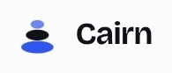

# Cairn



Cairn is a personal-agent app that handles errands, money and scheduling, and asks before it acts. A cairn marks a path; Cairn's agent shows where it has been and asks before it goes further.

**Status:** Phase 1, design system, in progress. The workspace, contract, mock server, blank API, design tokens, a first set of accessible components (button, text field, select, checkbox, switch, dialog, menu, toast) and a web shell with light, dark and high-contrast themes exist. Nothing is deployed yet.

## Plans

| Doc                                                          | What it covers                                                   |
| ------------------------------------------------------------ | ---------------------------------------------------------------- |
| [docs/frontend-plan.md](docs/frontend-plan.md)               | Frontend architecture, 13 phases, craft standards, quality gates |
| [docs/backend-plan.md](docs/backend-plan.md)                 | Backend architecture, trust layer, 13 phases, solo timeline      |
| [docs/decisions.md](docs/decisions.md)                       | Decisions made and decisions still open                          |
| [docs/motion.md](docs/motion.md)                             | Motion rules and timing                                          |
| [docs/i18n.md](docs/i18n.md)                                 | Translation and right-to-left approach                           |
| [docs/design-system-checks.md](docs/design-system-checks.md) | Storybook, accessibility and screenshot checks                   |

The full versions, with architecture and roadmap drawings, live as documents in the Cairn project on claude.ai. The links are at the top of each plan file.

## Ground rules

- **Own identity.** Cairn's colors, type, mascot and copy are its own. Research on another app's web build informed structure only. None of its assets, names, copy or icons are used here.
- **Contract first.** The OpenAPI spec and streaming event schema are the source of truth for both sides.
- **Trust before power.** Approvals, permissions and the audit log exist before any tool can change anything outside Cairn.
- **Web first.** An installable web app comes first; native apps come later.
- **Quality gates.** A phase does not close until its gates pass in CI.

## Getting started

Needs Node 22 and pnpm 10.

```
pnpm install
pnpm verify              # generated types, typecheck, lint, format, tests, build
pnpm verify:visual       # every Storybook story: accessibility with contrast, and screenshots
pnpm --filter @cairn/ui storybook   # components on :6006
pnpm --filter @cairn/mock-server dev   # mock API on :4000
pnpm --filter @cairn/api dev           # blank API on :4000
pnpm --filter @cairn/web dev           # web shell on :3000
```

After editing `packages/contract/openapi/cairn.v1.yaml`, run `pnpm gen`. The conformance suite runs against both the mock and the real API.

## Repository layout

```
apps/web          Next.js frontend
apps/api          TypeScript backend
packages/contract OpenAPI spec, event schema, generated client, conformance suite
packages/mock-server  Deterministic mock of the API
packages/tokens   Design tokens from the logo
packages/ui       Design system components
infra/            Infrastructure as code (later)
docs/             Plans and decision log
assets/brand/     Logo and brand files
```

`apps/web`, `apps/api`, `packages/*`, `docs/` and `assets/` exist today.

## License

AGPL-3.0-only for the apps, design tokens and UI; Apache-2.0 for the API contract and mock server. The Cairn name and logo are not covered by either license. See [LICENSING.md](LICENSING.md), [TRADEMARKS.md](TRADEMARKS.md) and [CONTRIBUTING.md](CONTRIBUTING.md). Contributors sign the [CLA](CLA.md).
